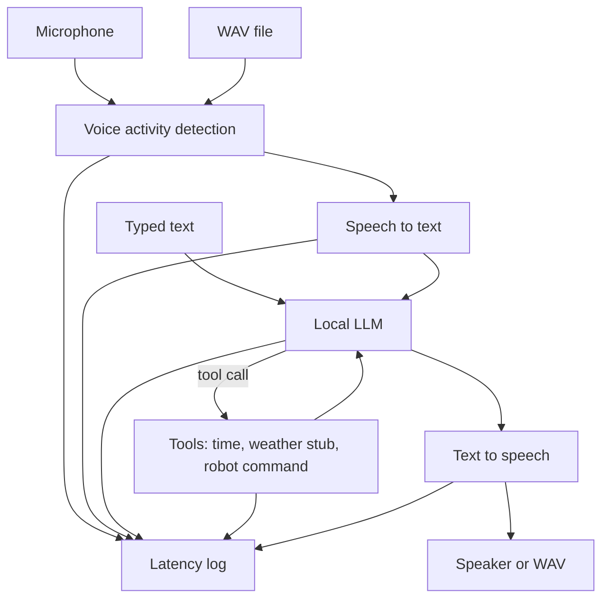

# Offline voice assistant

Demo of a fully offline voice pipeline for a humanoid robot: voice activity detection, speech-to-text, a local language model, and text-to-speech, with per-stage timings.

This repository is a **demo project**. It shows how the pieces fit together on a device that does not call a cloud model. It does not ship weights, it does not drive robot hardware, and it does not publish benchmark numbers for a Raspberry Pi or an NVIDIA Jetson.

The default config uses fake speech, language, and voice backends so you can run the control flow, the tool calls, and the latency logger without downloading models. Real adapters are included for [Silero VAD](https://github.com/snakers4/silero-vad) and [webrtcvad](https://github.com/wiseman/py-webrtcvad), [faster-whisper](https://github.com/SYSTRAN/faster-whisper), [llama-cpp-python](https://github.com/abetlen/llama-cpp-python), [Ollama](https://ollama.com/), and [Piper](https://github.com/rhasspy/piper).

## Architecture

Both modes endpoint audio with VAD and run speech-to-text on a finished utterance. Streaming applies to the language model and to sentence-sized Piper calls. The faster-whisper adapter uses Whisper's segment API, so this demo does not claim streaming recognition.



| Stage | Interface | Backends |
| --- | --- | --- |
| VAD | `trim(audio)` | `energy` (built in), `webrtcvad`, `silero` |
| STT | `transcribe(audio)` | `fake`, `faster-whisper` |
| LLM | `complete` / `stream` | `fake`, `llama-cpp`, `ollama` |
| TTS | `synthesize(text)` | `fake`, `piper` |
| Tools | `execute(call)` | local time, offline weather stub, robot gesture stub |

The language-model backends share one text protocol. A tool call is a single block:

```text
<tool>{"name":"robot","arguments":{"command":"wave"}}</tool>
```

After the tool result is appended, the model is asked again for a short spoken answer. `config/*.yaml` chooses the backend. The fake model follows the same protocol, which is what the tests exercise.

## Quick start

Python 3.11 or newer.

```bash
python -m venv .venv
source .venv/bin/activate
pip install -e ".[dev]"

offline-voice run --config config/demo.yaml --text "what time is it"
offline-voice run --config config/demo.yaml --mode stream --text "what is the weather"
offline-voice latency --config config/demo.yaml --text "please wave"
```

`samples/utterance.wav` is a synthetic 440 Hz tone between silence. It is not a person speaking. Energy VAD trims it, then the fake speech-to-text backend returns the transcript configured in `config/demo.yaml` (`what time is it`). That is the point of the demo path: the audio stages run, and the words come from the fake backend rather than from a recognizer.

```bash
offline-voice run --config config/demo.yaml --wav samples/utterance.wav --out out/reply.wav
```

Microphone capture is optional and records a fixed window (default 5 seconds), then runs the same pipeline:

```bash
pip install -e ".[mic]"
offline-voice run --config config/demo.yaml --mic --seconds 4 --out out/reply.wav
```

## Tools

| Tool | Behavior |
| --- | --- |
| `time` | Local device clock. No network. |
| `weather` | Offline stub. It records a location string and states that no forecast was fetched. |
| `robot` | Accepts `wave`, `nod`, `stop`, `look_left`, `look_right`. It returns a queued-command line and does not move servos. |

## Setup for real models

Install only the extras you need:

```bash
pip install -e ".[stt]"    # faster-whisper
pip install -e ".[llm]"    # llama-cpp-python
pip install -e ".[tts]"    # piper-tts, if the piper binary is not on PATH
pip install -e ".[vad]"    # webrtcvad
pip install -e ".[silero]" # torch, for Silero VAD
```

`config/default.yaml` points at faster-whisper `tiny` (int8, CPU), a Qwen2.5 0.5B Instruct GGUF, and the Piper `en_US-lessac-medium` voice. Paths are relative to the working directory. Run commands from the repository root.

Preview the download plan. This does not contact the network:

```bash
python scripts/download_models.py
```

Download the Piper voice (about 60 MB) and the GGUF (about 469 MB). The script checks SHA-256 against the Hugging Face LFS ids recorded in `offline_voice.download`.

```bash
python scripts/download_models.py --piper --llm
```

faster-whisper downloads its own weights on the first transcription. A small CPU starting point:

```bash
python -c "from faster_whisper import WhisperModel; WhisperModel('tiny', device='cpu', compute_type='int8')"
```

Ollama is the other language-model backend. It uses its own store:

```bash
ollama pull qwen2.5:0.5b
offline-voice run --config config/jetson.yaml --text "what time is it"
```

`config/jetson.yaml` expects Ollama on `127.0.0.1:11434`. Point `llm.backend` at `llama-cpp` instead when you have a local GGUF.

Then:

```bash
offline-voice run --config config/default.yaml --wav path/to/utterance.wav --out out/reply.wav
```

## CLI

```text
offline-voice run --config config/demo.yaml (--wav FILE | --mic | --text TEXT)
offline-voice latency --config config/demo.yaml (--wav FILE | --mic | --text TEXT)
```

| Flag | Role |
| --- | --- |
| `--mode turn\|stream` | Override the config. `turn` speaks once. `stream` synthesizes each sentence as the model emits it. |
| `--out FILE` | Write the spoken WAV. |
| `--seconds N` | Microphone window. Default 5. |
| `--json` | One JSON object, including the timings this process measured. |
| `--latency-log FILE` | JSONL path. Empty string skips the file. |

Each JSONL row has `stage`, `duration_ms`, `backend`, and `measured_by: "script"`.

## Latency

This repository does not publish measured latency for Whisper, llama.cpp, Ollama, Piper, a Raspberry Pi, or a Jetson. The table is a **placeholder**. The duration cells are blank on purpose. A filled-in number in this file would be an invented benchmark.

Produce a table on your own machine. The command prints only timings that process measured, and it labels every row `measured by script` together with the backend name (`fake`, `faster-whisper`, `llama-cpp`, `ollama`, `piper`, `energy`, ...).

| Stage | Backend | Duration (ms) | Source |
| --- | --- | ---: | --- |
| vad |  |  | placeholder, not a measurement |
| stt |  |  | placeholder, not a measurement |
| llm |  |  | placeholder, not a measurement |
| tools |  |  | placeholder, not a measurement |
| tts |  |  | placeholder, not a measurement |
| total |  |  | placeholder, not a measurement |

```bash
offline-voice latency --config config/demo.yaml --text "what time is it"
offline-voice latency --config config/default.yaml --wav samples/utterance.wav
```

A run with `config/demo.yaml` measures the fake backends. Those durations are real measurements of the mock pipeline. They are not speech-model latency and they are not robot latency.

`samples/utterance.wav` is a tone. Using it with `config/default.yaml` exercises VAD and the real model path; it is not a speech corpus, and a recognizer may return an empty or useless transcript for it.

## Raspberry Pi

`config/pi.yaml` is a starting point for a 64-bit Raspberry Pi 4 or Pi 5, not a tuned profile.

- Prefer `energy` or `webrtcvad`. Silero needs PyTorch, which is a poor fit for a small Pi image.
- faster-whisper `tiny` or `base`, `device: cpu`, `compute_type: int8`.
- Stay with a small GGUF (the 0.5B Q4 file from the download script, or another model you choose) if the board has 4 GB of RAM. `llama-cpp-python` needs a compiler and CMake on the Pi.
- Piper's medium English voice is a reasonable CPU voice. The low-size Piper voices are smaller if medium is tight.
- Use a USB microphone and 16 kHz mono. The CLI's `--mic` path needs the `mic` extra (`sounddevice`).
- Read the latency table from `offline-voice latency` on that board. Do not copy timings from a desktop.

```bash
sudo apt-get install -y python3-venv python3-pip build-essential cmake
python3 -m venv .venv
source .venv/bin/activate
pip install -e ".[stt,llm,vad,mic]"
python scripts/download_models.py --piper --llm
offline-voice run --config config/pi.yaml --wav samples/utterance.wav
```

## NVIDIA Jetson

`config/jetson.yaml` is a starting point for a Jetson in the Orin class on JetPack 6, not a tuned profile.

- The PyPI `faster-whisper` / CTranslate2 wheel is a generic build. CUDA transcription needs a CTranslate2 build that matches that Jetson's CUDA. Until you have one, set `stt.device` to `cpu`.
- Ollama's ARM64 build is usually the shorter language-model path. A CUDA build of llama.cpp is board-specific; switch `llm.backend` to `llama-cpp` only after that build exists.
- Piper stays on CPU. The voice file is small next to the language model.
- Power mode changes results. Measure with `offline-voice latency` on the device you care about.
- If you already use NVIDIA's PyTorch and want Silero, a virtualenv created with `--system-site-packages` can see that torch. The demo does not require it.

## Tests

Unit tests mock speech-to-text, the language model, and text-to-speech. They do not download weights. GitHub Actions runs Ruff and pytest on Ubuntu with Python 3.11.

```bash
ruff check .
pytest
```

## Layout

```text
config/                  demo, default, Pi, and Jetson YAML
samples/utterance.wav    synthetic tone for the VAD path
scripts/download_models.py
src/offline_voice/       pipeline, backends, CLI, latency log
tests/                   fake-backend unit tests
```

## License

MIT, copyright Arpan Bom.
